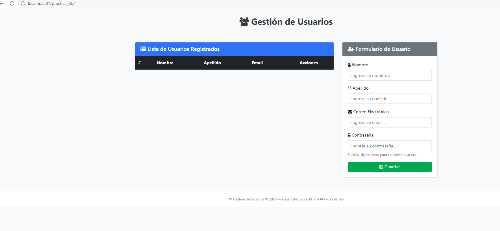

# 🚀 Sistema de Gestión de Usuarios (CRUD en PHP, MySQLi y AJAX)

> 🎓 **Proyecto Académico / Educativo**  
> Desarrollado por **Juan Carlos Medina** con fines de aprendizaje y demostración de arquitectura web asíncrona (CRUD) utilizando PHP, MySQLi, AJAX y Bootstrap 4.

[](https://www.php.net/)
[](https://www.mysql.com/)
[](https://getbootstrap.com/)
[](https://jquery.com/)

Aplicación web interactiva para la administración y gestión completa de usuarios (Crear, Leer, Actualizar y Eliminar). Diseñada bajo una arquitectura ligera y asíncrona mediante peticiones AJAX, evitando recargas de página y garantizando respuestas en formato JSON.

---

## 💻 Vista Previa de la Aplicación



---

## 🛠️ Tecnologías Utilizadas

* **Frontend:** HTML5, CSS3, Bootstrap 4, Font Awesome 4.7 y jQuery 3.6.0.
* **Backend:** PHP (con extensión nativa MySQLi).
* **Base de Datos:** MySQL (Motor InnoDB, codificación `utf8mb4`).
* **Protocolo de Comunicación:** AJAX / Peticiones HTTP asíncronas con respuestas JSON.

---

## 📁 Estructura del Proyecto

```text
practica_db/
│
├── index.html          # Interfaz principal de la aplicación
├── esquema.md          # Documentación del diseño o arquitectura
├── readme.md           # Archivo de Documentación de la estructura del proyecto
├── database.sql        # Script para la creación de la base de datos y tablas
├── assets/
│   ├── js/
│   │   └── app.js      # Peticiones AJAX y manipulación del DOM
│   ├── css/            # Hojas de estilo personalizadas
│   │   └── app.css     # Estilos personalizados de la aplicación
│   └── img/            # Recursos gráficos e imágenes
│       └── index.png   # Imagen de la vista previa del index
└── php/
    ├── conexion.php    # Configuración de base de datos y conexión mysqli
    ├── listar.php      # Consulta y obtención de registros
    ├── agregar.php     # Inserción de nuevos datos
    ├── editar.php      # Actualización de registros existentes
    ├── eliminar.php    # Eliminación de registros
    └── seleccionar.php # Consulta individual por ID
```

---

## ⚙️ Requisitos e Instalación Local

### Requisitos Previos
* Servidor local como **XAMPP**, **WAMP**, **LAMPP**, **Laragon** o **MAMP**.
* PHP v7.4 o superior.
* Servidor MySQL / MariaDB (LAMPP / XAMPP, Laragon, WAMP o servicio independiente de MySQL).

### Pasos de Configuración

1. **Clonar el repositorio:**
   ```bash
   git clone [https://github.com/jcmedinaf/practica_db.git](https://github.com/jcmedinaf/practica_db.git)
   ```
2. **Mover el proyecto al servidor web:**
   * Coloca la carpeta `practica_db` dentro del directorio de tu servidor web (ej. `htdocs` en XAMPP/LAMPP o `www` en Laragon).

3. **Configurar la Base de Datos:**
   * Abre **phpMyAdmin** o tu gestor de base de datos preferido.
   * Importa el archivo `database.sql` incluido en la raíz del proyecto.
   * Esto creará automáticamente la base de datos `practica_db` y la tabla `usuarios`.

4. **Verificar la Conexión:**
   * Revisa el archivo `php/conexion.php` y ajusta las credenciales de conexión si tu usuario o contraseña de MySQL difieren de los valores por defecto:
     ```php
     $servidor = "localhost";
     $usuario = "root";
     $password = "";
     $base_datos = "practica_db";
     ```

5. **Ejecutar la Aplicación:**
* Opción 1 (Servidor integrado de PHP - Recomendado y rápido):
    Abre tu terminal en la carpeta raíz del proyecto y ejecuta el siguiente comando:

        php -s localhost:8000
        Luego, abre tu navegador web e ingresa a: http://localhost:8000/index.html

* Opción 2 (Servidor local tradicional como XAMPP / Laragon / LAMPP):

    Mueve la carpeta del proyecto a tu directorio web (ej. htdocs) e ingresa a:
    http://localhost/practica_db/index.html
   * Abre tu navegador web e ingresa a: `http://localhost/practica_db/index.html` (o el puerto configurado en tu entorno local, ej. `http://localhost:3000/index.html`).

---

## 🔒 Características de Seguridad Destacadas

* **Protección contra Inyección SQL:** Sanitización estricta mediante `(int)` para IDs y `mysqli_real_escape_string` para entradas de texto.
* **Cifrado de Contraseñas:** Uso del algoritmo de hashing unidireccional seguro `password_hash()` de PHP.
* **Protección de Claves en Edición:** Si al editar un usuario el campo de contraseña se deja vacío, el sistema conserva intacta la clave hash existente en la base de datos.
* **Manejo de Errores y Validaciones:** Respuestas estructuradas en JSON con control de estados (`exito` / `error`) y validación de correo mediante `FILTER_VALIDATE_EMAIL`.

---

## 👨‍💻 Autoría y Propósito

Este proyecto fue desarrollado íntegramente por **Ing. Juan Carlos Medina** con fines puramente educativos y demostrativos. 

* **Propósito:** Servir como guía práctica y material didáctico sobre el desarrollo de aplicaciones web interactivas (CRUD) mediante peticiones asíncronas (AJAX), arquitectura limpia y buenas prácticas de seguridad en PHP.
* **Licencia:** Libre para uso académico y de aprendizaje.